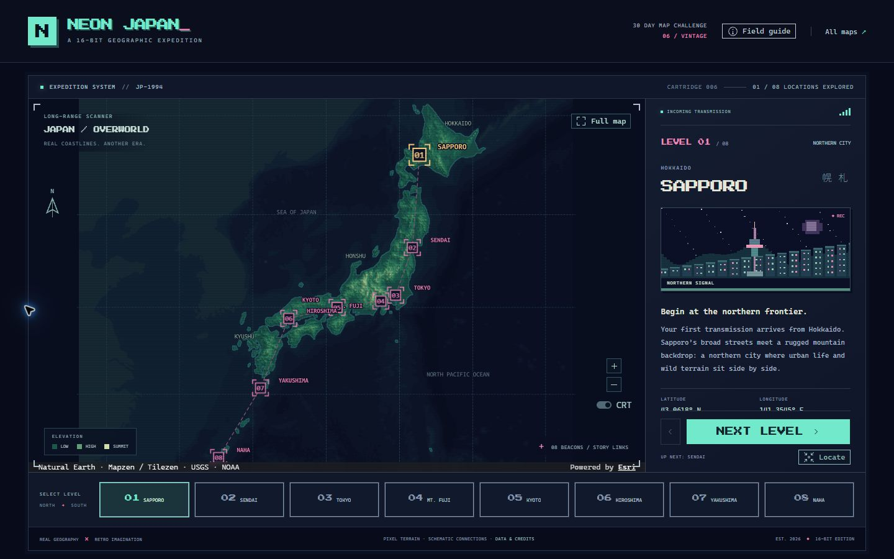

# Day 6: Neon Japan

**Theme:** Vintage · **Date:** November 6, 2026 · **Status:** Complete

A 16-bit sci-fi expedition through real Japanese geography. Follow eight levels from Hokkaido to Okinawa, inspect neon beacons, and explore an elevation map drawn like a cartridge-era overworld.

[Open the map](index.html) · [All challenge days](../directory/index.html) · [GitHub source](https://github.com/PaulGibbs3rd/30DayMapChallenge2026/tree/main/day6)



## The expedition

| Level | Place | Landscape | Place reference |
| --- | --- | --- | --- |
| 01 | Sapporo | Northern city | [JNTO](https://www.japan.travel/en/destinations/hokkaido/hokkaido/sapporo-and-around/) |
| 02 | Sendai | Forest city | [JNTO](https://www.japan.travel/en/destinations/tohoku/miyagi/sendai-area/) |
| 03 | Tokyo | Megacity and coastal plain | [JNTO](https://www.japan.travel/en/destinations/kanto/tokyo/) |
| 04 | Mount Fuji | Volcanic summit | [UNESCO](https://whc.unesco.org/en/list/1418/) |
| 05 | Kyoto | Cultural landscape | [JNTO](https://www.japan.travel/en/world-heritage/historic-monuments-of-ancient-kyoto/) |
| 06 | Hiroshima | River delta and peace memorial | [JNTO](https://www.japan.travel/en/spot/2202/) |
| 07 | Yakushima | Ancient forest and island mountains | [JNTO](https://www.japan.travel/en/spot/ma_229/) |
| 08 | Naha | Subtropical island | [JNTO](https://www.japan.travel/en/destinations/okinawa/okinawa/naha-and-the-main-island/) |

Use **Next level** and **Previous level** for the guided sequence. Select a level or map beacon to jump directly to a place. **Locate** centers the current beacon; **Full map** restores the overworld. Drag and zoom for free exploration. The **CRT** switch removes the scanline texture. The last stop offers a replay; explored locations remain marked.

Progress is stored in browser local storage when available. The map and story still work when storage is unavailable. The Field guide contains controls, source links, attribution, and interpretation notes.

## Data and attribution

Retrieved **November 6, 2026**.

- **Coastlines:** Natural Earth admin-0 countries, 1:50 million. [Source GeoJSON](https://raw.githubusercontent.com/nvkelso/natural-earth-vector/master/geojson/ne_50m_admin_0_countries.geojson) · [Public-domain terms](https://www.naturalearthdata.com/about/terms-of-use/). Country geometry provides the land mask; Japan receives the elevation palette and surrounding land is muted.
- **Elevation and bathymetry:** [Mapzen / Tilezen Terrain Tiles on AWS](https://registry.opendata.aws/terrain-tiles/), Terrarium format, zoom 6. The build uses 36 tiles: columns 53–58, rows 22–27. Global GMTED2010 and SRTM data courtesy of the U.S. Geological Survey; global ETOPO1 courtesy of the U.S. National Oceanic and Atmospheric Administration. [Provider attribution and licenses](https://github.com/tilezen/joerd/blob/master/docs/attribution.md).
- **Place stories:** Original summaries based on Japan National Tourism Organization and UNESCO, linked per level above.
- **Coordinates:** Manually curated approximate representative WGS84 coordinates, stored with their meanings in the level definitions. Tokyo represents the station area; Hiroshima represents the Atomic Bomb Dome; Yakushima is an island reference point. They are not surveyed boundaries, entrances, or directions.
- **Typography:** Press Start 2P by CodeMan38, [SIL Open Font License 1.1](fonts/OFL.txt), downloaded from the [Google Fonts source repository](https://github.com/google/fonts/tree/main/ofl/pressstart2p).
- **Illustrations:** Original deterministic Canvas pixel scenes. They are interpretive designs, not photographs or accurate architectural models.

The raster is decoded to heights before resampling to avoid mixing Terrarium RGB encoding. A Web Mercator 768 × 768 grid is painted with discrete elevation bands and quantized directional shading, with a pixel coastline accent, then enlarged to 3072 × 3072 using nearest-neighbor sampling. Elevation band breaks are 100, 350, 700, 1,200, 1,900, and 2,600 m. Color and hillshade are artistic treatments; the legend is qualitative.

The exported raster and its georeference are in the local data folder. It covers approximately 118.125–151.875° E and 21.943–48.922° N. Small islands and terrain details may disappear at this resolution. The main tour does not represent every part of Japan.

**Connections are schematic story links**, not roads, transport routes, or travel advice. The 1994 cartridge identity is fictional; this map does not claim to depict Japan as it was in 1994.

## Implementation

Scaffolded with the official CLI:

```sh
cd day6/scripts
npx @arcgis/create --name app --template js-maps-sdk-vite
```

The retained Vite / TypeScript template uses ArcGIS Maps SDK for JavaScript **5.2.1**, Map Components **5.2.1**, and Calcite Design System **5.2.1**, as resolved in its lockfile. The app follows the ArcGIS JavaScript, Calcite, requirements, and authentication skills.

An ArcGIS Map component renders a local georeferenced MediaLayer, graticule graphics, schematic connections, and selectable beacons. Calcite supplies the shell, buttons, dialog, labels, and switch. Its documented tokens style the console. The interface adapts from a map/detail layout on desktop to a vertical story on phones; desktop navigation stays visible while the story scrolls.

No API key, ArcGIS sign-in, portal item, or protected data is needed. Terrain and story data are bundled locally. The SDK may still request its default runtime resources and text glyphs over the internet; this is not a fully disconnected application.

## Reproduce and run

Use Node.js 24.

```sh
cd day6/scripts/app
npm ci
npm run dev
```

To build and export the checked-in static runtime:

```sh
cd day6/scripts/app
npm run export
```

This prepares the required local Calcite icons and English messages, runs TypeScript, builds with Vite, and exports generated runtime files into Day 6. Relative build paths support the collection's GitHub Pages subpath.

The existing repository preview serves the exported version:

```sh
npm run dev
# Open /30DayMapChallenge2026/day6/ on the printed local server.
npm run check
```

To regenerate terrain, run the Python build script using Python with Pillow and NumPy. The script downloads public inputs and caches them under the ignored Day 6 metadata directory. Existing checked-in terrain requires no Python installation to run or rebuild the web app.

## Validation

- TypeScript and Vite production build.
- Eight guided levels, replay, direct level selection, previous navigation, keyboard activation, map overview and locate, zoom controls, CRT toggle, and Field guide.
- Desktop and phone layouts, including narrow screens and no horizontal overflow.
- Day 6 export checker: 8,865 local references, relative hosting paths, terrain dimensions/georeference, required Calcite resources, and directory metadata passed. Run `node day6/scripts/check-export.mjs` after the collection build.
- The full collection `npm run check` passed on a clean publication snapshot: existing data tests, 30 dated entries, 29,188 local runtime references, clean static packaging, and matching Day 2 asset versions.
- Data source, coordinates, and illustrative limitations documented in the map and these notes.

## Reflection

Vintage is treated as the visual language of a 16-bit console rather than an antique paper map. Pixelating the geography itself makes the reference visible in the coastline and terrain, while a limited palette, original scene illustrations, numbered levels, and neon controls carry it into the interface. A real elevation model keeps the fantasy grounded in the shape of the archipelago.

[Requirements handoff](requirements.md) · [Official challenge](https://30daymapchallenge.com/2026/)
